# Atividade de Git — Olá, Professor!

**Data:** 20/10/2026

**Repositório:** https://github.com/OtavioMR/SilvioFatecGit

**Site:** https://ola-professor-cyan.vercel.app/

## O que eu fiz

Eu criei uma página chamada **Olá, Professor!** usando HTML, CSS e JavaScript. A saudação muda de acordo com o horário e a página se adapta a telas menores.

Durante a atividade, pratiquei os principais comandos do Git. Criei commits e branches, resolvi um conflito, usei rebase e cherry-pick e experimentei formas de recuperar alterações. Também pratiquei tags, worktrees e comunicação com repositórios remotos.

## Publicação

Enviei o projeto para o GitHub e publiquei o site no Vercel. Depois, conectei o repositório GitHub ao projeto Vercel. Confirmei a integração quando um push para a branch `main` gerou um deploy automático com status **Ready**.

## Conclusão

Consegui praticar o fluxo do Git em um projeto completo, do primeiro commit até a publicação. Também deixei o código, os registros e as capturas disponíveis no repositório.

## Prints da atividade

As imagens 02 a 10 mostram o painel onde registrei os passos do roteiro. As demais são capturas do site, do GitHub e do Vercel.

### 01 — Página aberta no navegador

### 02 — Ferramentas e configuração do Git
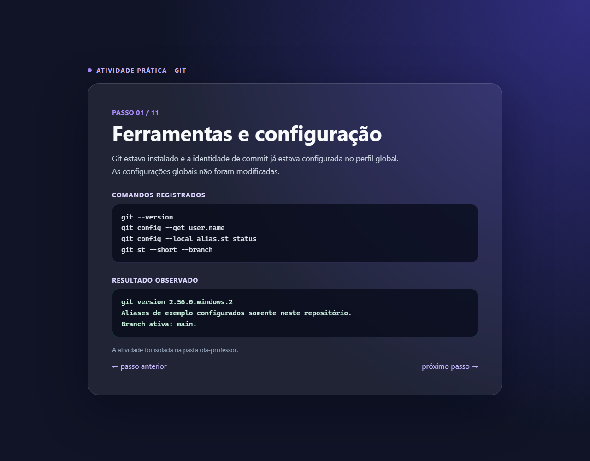

### 03 — Criação do projeto
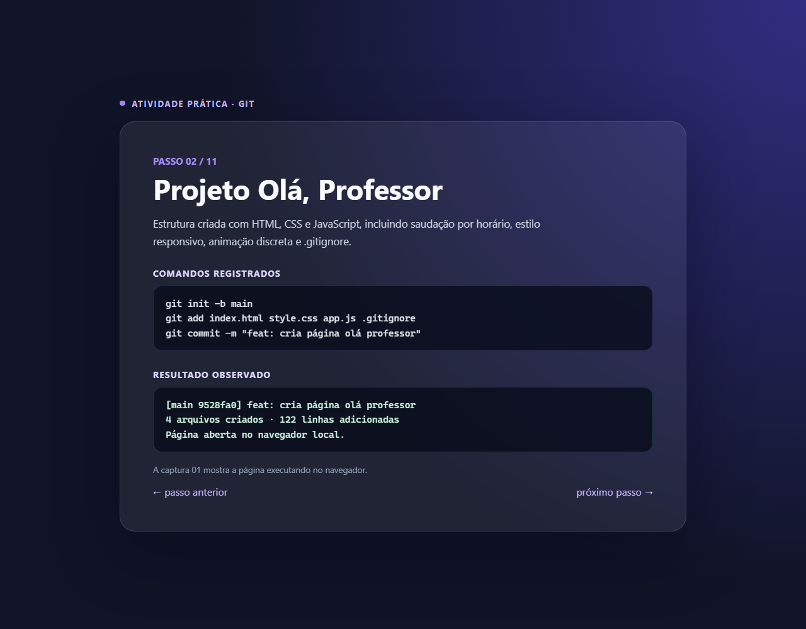

### 04 — add, commit e log
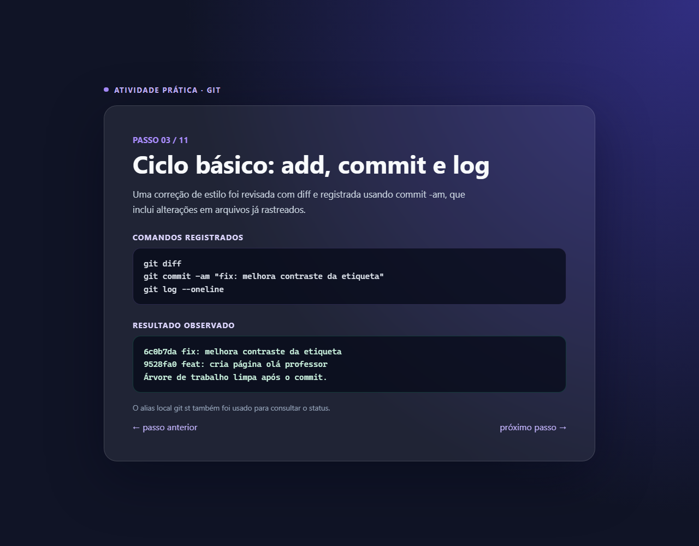

### 05 — Branches e conflito resolvido
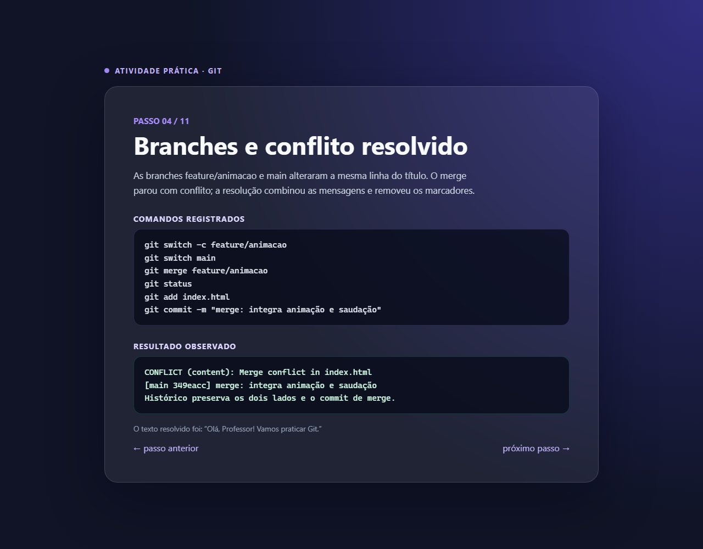

### 06 — Rebase e cherry-pick
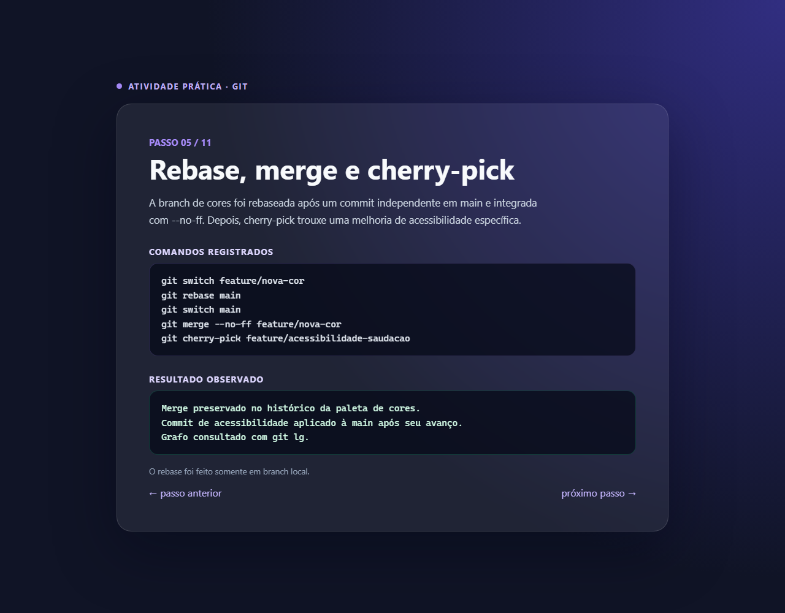

### 07 — Recuperação de alterações
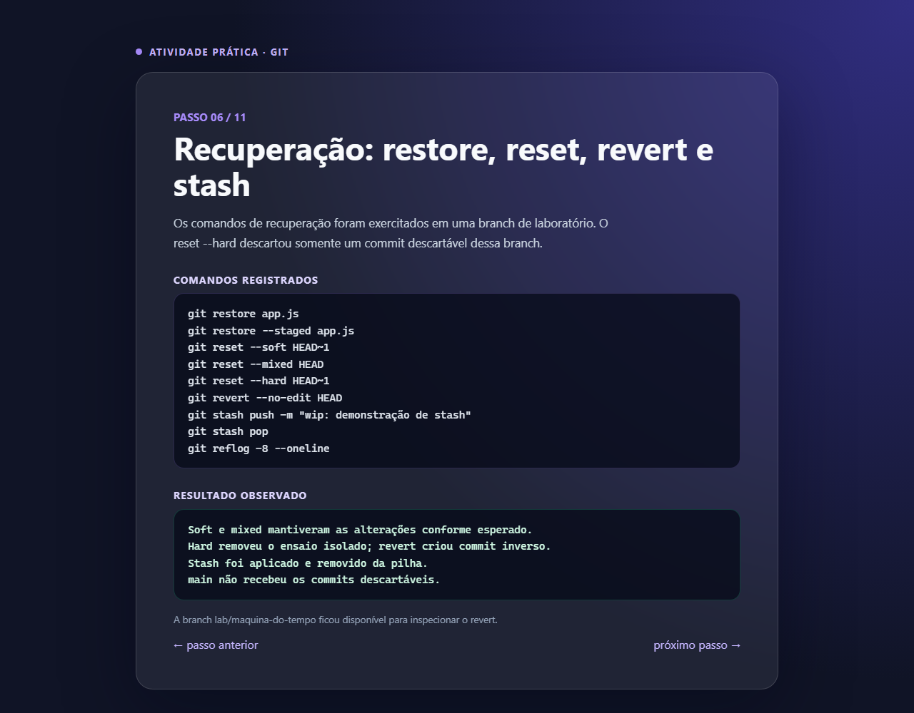

### 08 — Bisect e hook
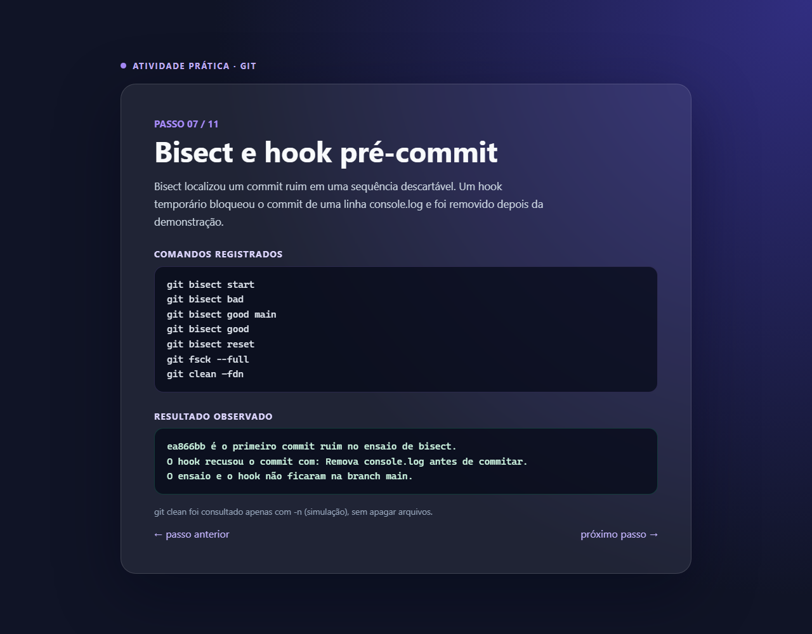

### 09 — Worktree e tags
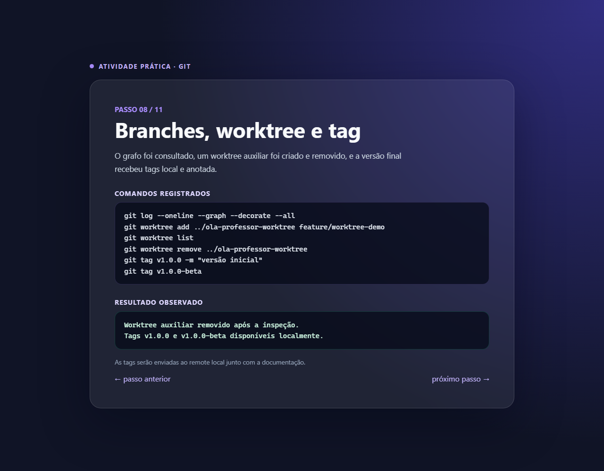

### 10 — Push, fetch e clone
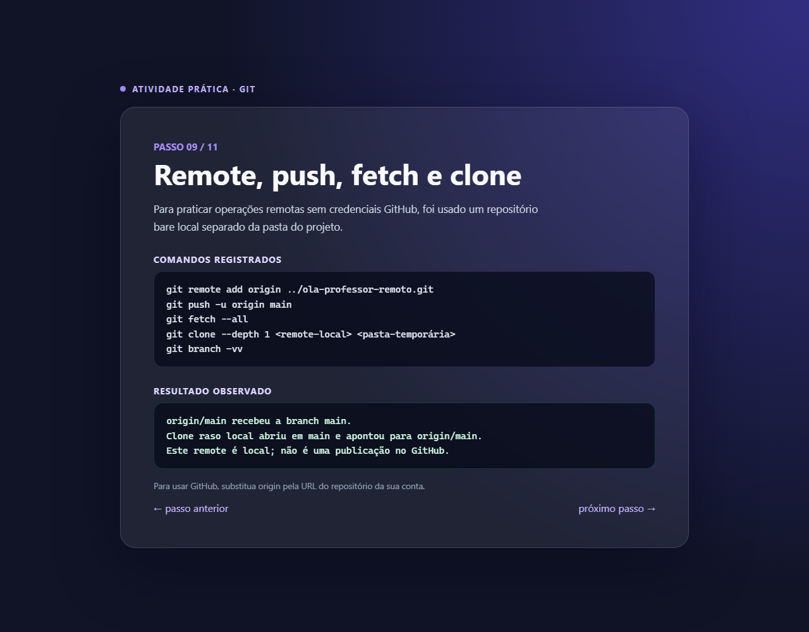

### 11 — Site publicado

### 12 — Deploy pelo Vercel
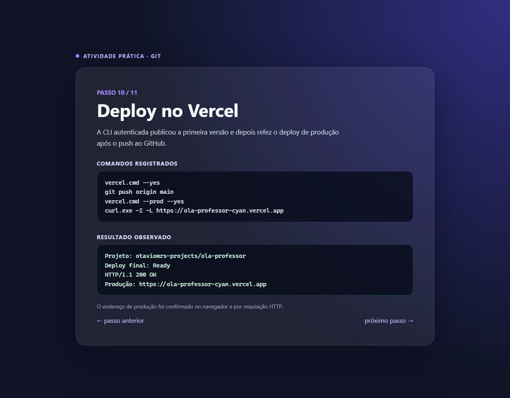

### 13 — Repositório no GitHub
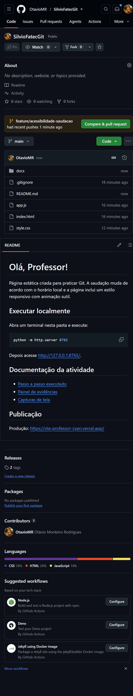

### 14 — Estado final do repositório
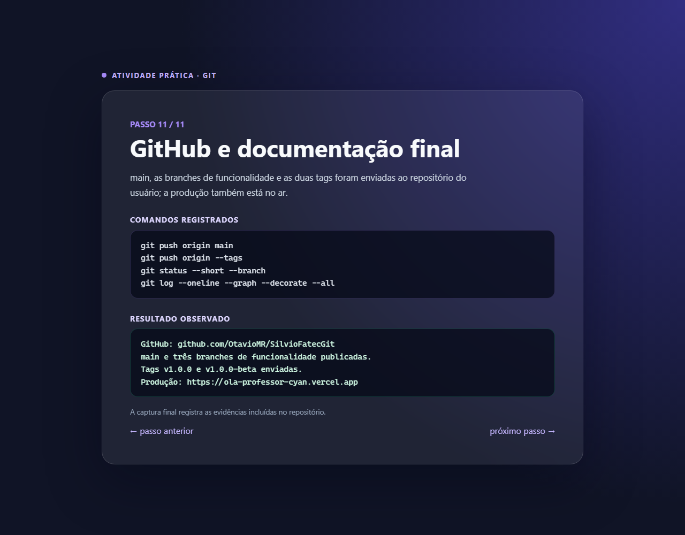

### 15 — Deploy originado do GitHub
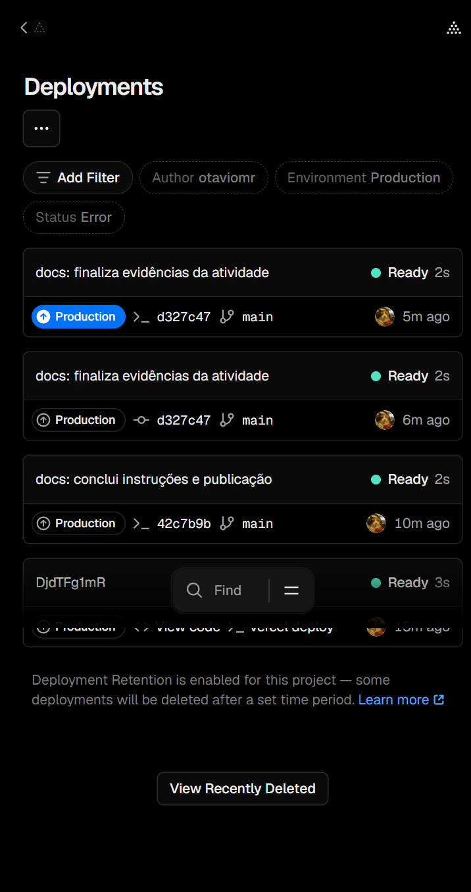

### 16 — Repositório conectado ao Vercel
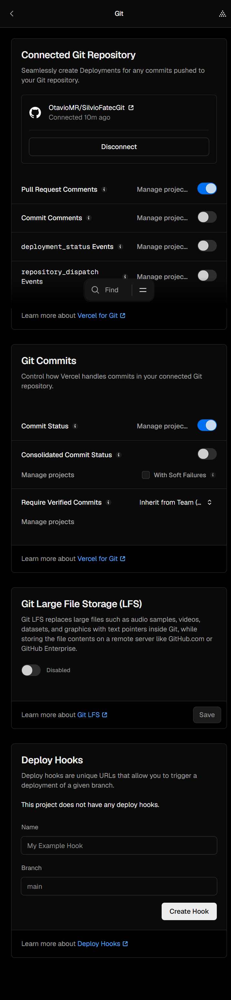

### 17 — Deploy automático concluído
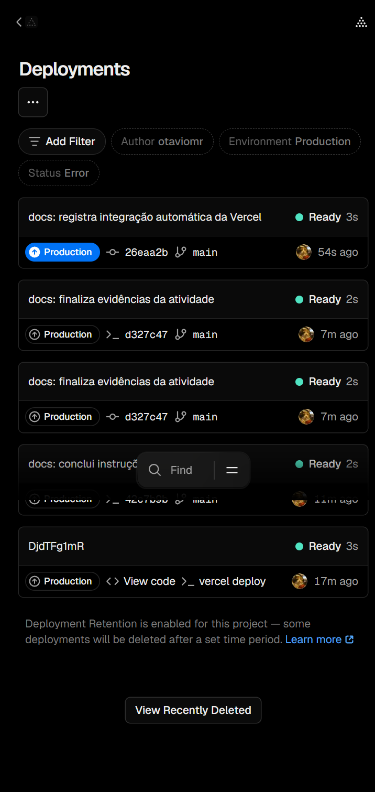
